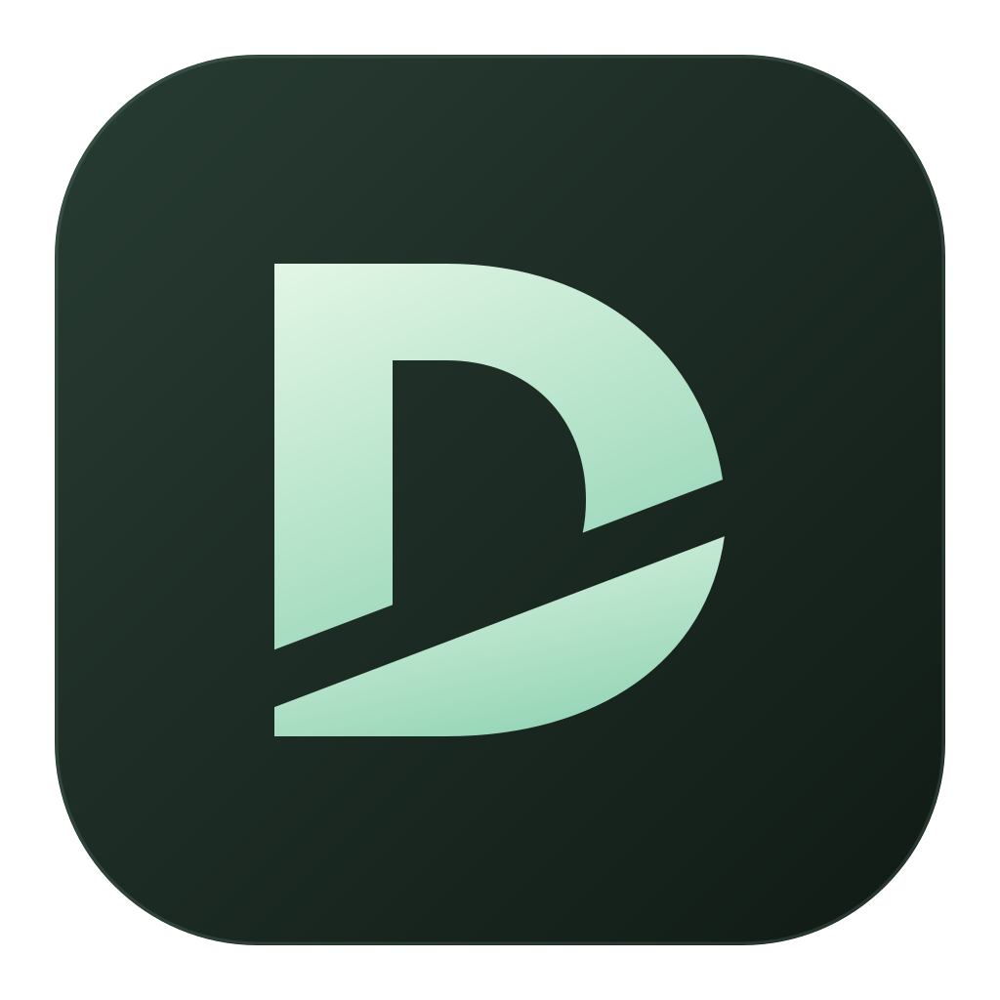

<div align="center">
  
  <h1>Descripto</h1>
  <p><strong>Edit your video by editing its transcript.</strong></p>
  <p>A local video editor from <a href="https://github.com/earlyaidopters">Early AI-dopters</a>, with instant cut previews and your own AI connections.</p>
  <p><a href="#quick-start">Install</a> · <a href="#connect-your-providers">Connect providers</a> · <a href="#your-first-edit">First edit</a> · <a href="#troubleshooting">Troubleshooting</a> · <a href="LICENSE">MIT license</a></p>
</div>

Descripto turns a recording into a word-level transcript. Delete words, remove detected fillers, or ask the assistant to make an edit. The script, timeline, and live preview update together. Export the finished video when you are ready.

**This is a source release.** Download or clone the repository, install its dependencies, and run it on your own computer. There is no hosted service, shared API key, or standalone signed installer. The macOS `.app` you can build is a launcher that depends on your local checkout.

## What it does

| Feature | How it works |
| --- | --- |
| Transcript editing | Select words and delete or restore them. Undo/Redo works during the current editor session. |
| Immediate preview | Playback skips cut ranges without waiting for an export. Deleted words disappear; **Show cuts** reveals them for restoration. |
| Edited timeline | The timeline closes gaps after cuts. Both scrubbers, transcript timestamps, and project cards show edited time. |
| Filler cleanup | Remove locally detected fillers in one click, then restore individual words if needed. |
| Editing assistant | Describe an edit; a scoped Claude agent reads and changes the transcript. |
| Transcript proofreading | Ask Claude for word corrections and choose which suggestions to accept. |
| Video review | Render first, then let Gemini inspect the finished video for rough edits and other issues. |
| Studio Sound | Local FFmpeg filtering, denoising, compression, and loudness normalization; optional Auphonic finishing. |
| Export and cancellation | Render H.264/AAC MP4; **Cancel export** stops the job and removes unfinished output. A previous completed export is retained. |
| Captions | Download SRT captions using the kept words and edited timestamps. |
| Bring your own keys | Configure providers in **Settings → Connections**. Each person uses their own accounts. |

## Quick start

### 1. Install prerequisites

The desktop launcher is designed for **macOS 13 or later**. The browser interface can run locally on other operating systems, but Windows/Linux desktop packaging is not provided and cross-platform desktop behavior has not been verified.

You need:

- **Node.js 22.15 or newer**; a supported Node LTS release is recommended.
- **pnpm 12.6.0**, matching the version pinned in `package.json`.
- **FFmpeg and ffprobe** on your `PATH`.
- **Git** to clone, or GitHub's **Code → Download ZIP**.
- For the macOS `.app` launcher only: **Xcode Command Line Tools** (`clang` and `codesign`).

On a Mac with [Homebrew](https://brew.sh/) already installed:

```bash
brew install node ffmpeg
npm install --global pnpm@12.6.0
```

If you use a Node version manager, keep using it; a second Node installation is unnecessary. Check your tools:

```bash
node --version
pnpm --version
ffmpeg -version
ffprobe -version
```

### 2. Download and install

```bash
git clone https://github.com/earlyaidopters/descripto.git
cd descripto
pnpm install --frozen-lockfile
pnpm build
```

ZIP users: extract the archive, open a terminal in its `descripto-main` folder, and run the same install/build commands.

### 3. Run Descripto

**Desktop window:**

```bash
pnpm desktop
```

Electron starts a local server at `127.0.0.1:3210` and opens the studio. Keep the terminal running until you close the app.

**Local browser alternative:**

```bash
pnpm start
```

Open [http://127.0.0.1:3000](http://127.0.0.1:3000). The browser version uses local HTTP uploads when importing; recordings are written to this computer's project folder.

**Make a double-clickable Mac app:**

```bash
xcode-select --install  # once, if Command Line Tools are not installed
pnpm app
```

This creates `dist-app/Descripto.app`. Drag it to Applications, or explicitly install it with `pnpm app --install`. Quit any running copy before replacing it.

The launcher is ad-hoc signed, **not notarized**, and embeds paths to this checkout and your Node installation. Keep the source folder and `node_modules` in place. After moving the folder or changing Node versions, run `pnpm build` and `pnpm app` again. Copying this `.app` to a different computer will not install Descripto there; that person should follow these source-installation steps.

## Connect your providers

Click the gear icon, or press **⌘,** in the Mac app. Open **Connections**, paste a key, click **Save key**, and optionally **Test connection**. Changes take effect on the next operation.

You do **not** need every provider to begin:

| Provider | Used for | Setup |
| --- | --- | --- |
| Groq | Transcription with word timestamps | Add a key from your [Groq console](https://console.groq.com/keys). Default engine: `whisper-large-v3-turbo`. |
| Anthropic | Assistant edits and transcript proofreading | Add your own [Anthropic API key](https://platform.claude.com/). For the assistant, select API-key authentication in preferences. |
| Google Gemini | Reviewing a rendered video | Add a [Google AI Studio key](https://aistudio.google.com/apikey). Default model: `gemini-2.5-flash`. |
| Auphonic, optional | Cloud audio finishing | Add an [Auphonic API key](https://auphonic.com/engine/api/), choose Auphonic as the audio processor, and enable Studio Sound on the project. |

The assistant can alternatively use an existing Claude CLI sign-in. That option depends on your account's access and current provider terms; it does **not** replace the Anthropic API key required for proofreading. To use a saved Anthropic key for assistant requests, explicitly select API-key authentication in Settings.

Under **Model settings**, you can replace the Gemini, assistant, and proofreading model IDs with models available to your account. The source defaults are `gemini-2.5-flash`, `claude-sonnet-4-5`, and `claude-haiku-5-5`. Model availability, billing, limits, and provider policies can change. A successful connection test checks authentication, not every model or feature.

Provider usage is billed to your own account where applicable. The repository does not include credits or credentials.

### Local transcription option

If Groq is unavailable or not configured, Descripto tries the [OpenAI Whisper CLI](https://github.com/openai/whisper). Install Whisper separately in your preferred Python environment and ensure the `whisper` executable is on `PATH`, or configure its absolute path:

```dotenv
LOCAL_WHISPER_BIN=/absolute/path/to/whisper
LOCAL_WHISPER_MODEL=small
```

Both transcription paths currently request **English**. Local Whisper downloads its model if needed and can take substantially longer than the hosted service, depending on hardware and recording length.

### Environment configuration

Settings is the simplest setup. For environment-based configuration, copy the example:

```bash
cp .env.example .env.local
```

Fill only the keys you need. Next.js loads `.env.local` when its server starts, so restart after changing it. Supported key names are `GROQ_API_KEY`, `GOOGLE_API_KEY` (or `GEMINI_API_KEY`), `ANTHROPIC_API_KEY`, and `AUPHONIC_API_KEY`.

Saved settings take precedence over environment values. **Disconnect** disables that provider's environment fallback; **Use environment instead** removes the saved override. A blank key field does not erase an existing key. A legacy `~/.env` fallback and `ANTHROPIC_API_KEY_CONTENT_ENGINE` alias are also supported, but are unnecessary for a fresh installation.

## Your first edit

1. **Import a recording.** Use **New project**, drag a file into the library, or choose **File → Open Video…** in the Mac app. H.264 video with AAC audio in an MP4 container is the safest starting format.
2. **Create the transcript.** Configure Groq or local Whisper first. Once transcription finishes, each word is connected to the original recording's timestamps.
3. **Cut with text.** Drag across words, then press Delete/Backspace or use the floating Delete button. The words disappear and the timeline gets shorter immediately.
4. **Preview.** Click a word to play from it, or seek with either edited-time scrubber. Cuts are skipped live; rendering is unnecessary for ordinary preview.
5. **Restore or undo.** Use **Show cuts** to reveal removed words, select them, and choose Restore. Use the Undo/Redo buttons for recent changes. Undo history resets when the editor reloads; saved cut flags remain available through Show cuts.
6. **Optionally refine.** Remove detected fillers, request an assistant edit, or run Proofread and accept individual suggestions. Review the results before exporting—filler detection is heuristic, and words such as “like” may be meaningful.
7. **Render video.** Start an export when ready. The progress bar shows its stage. Use **Cancel export** to stop; the control is recovered if you reload while a job is running. Closing the desktop app also stops its local encoder processes.
8. **Use the result.** **Last export** plays the most recent completed MP4. Find the output under `projects/<project-id>/renders/` in this checkout. **Captions** downloads SRT for the current edit. Video review analyzes the completed export, so render again before reviewing newer edits.

Edits save to disk as you make them. Source media is preserved; cutting a word changes the project's edit decisions, not the original recording. Cancelling an export does not undo your cuts.

### Keyboard controls

| Action | Shortcut |
| --- | --- |
| Open media in the Mac app | ⌘O |
| Return to projects in the Mac app | ⌘⇧H |
| Settings in the Mac app | ⌘, |
| Cut selected words | Delete / Backspace |
| Undo / redo | ⌘Z / ⌘⇧Z (Ctrl equivalents in the browser) |
| Play from a focused transcript word | Enter |
| Select a focused transcript word | Space |

## Storage, privacy, and network access

**Local-first does not mean every feature runs offline.** Editing, live cut preview, filler detection, SRT generation, and built-in Studio Sound run locally. The following actions send content to the selected provider:

| Action | Content sent |
| --- | --- |
| Groq transcription | Extracted recording audio |
| Assistant editing / proofreading | Transcript text, timestamps, instructions, and relevant project metadata |
| Gemini video review | The completed rendered video and review prompt |
| Auphonic Studio Sound | Audio extracted from the edited export |

Local Whisper offers a local transcription fallback. Providers apply their own retention, usage, and billing policies. Auphonic productions may remain in your account; on cancellation the app attempts to stop the production and reports if it cannot confirm that stop.

Project files are stored under:

```text
projects/<project-id>/
  state.json       # transcript, cut flags, metadata, review/audit results
  source.*         # imported media
  renders/         # completed exports
  ...              # temporary transcription working files
```

The desktop importer attempts an APFS copy-on-write clone where available and falls back to a normal copy. Large imports may require substantial disk space on other filesystems. Project state currently contains absolute media paths, so moving a whole project folder is not a supported portable-project import flow.

Connection settings are stored outside the repository:

- macOS: `~/Library/Application Support/Descripto/connections.json`
- Other systems: the app's config directory under `APPDATA`, `XDG_CONFIG_HOME`, or `~/.config`
- Override for isolated development: `DESCRIPTO_CONFIG_DIR=/path/to/private/config`

The settings file is **not encrypted**. The app uses owner-only file permissions on supporting systems and does not return saved key values through the settings API. Do not share it, `.env` files, or your `projects/` directory. All are excluded from this repository.

Descripto is a **trusted, single-user local application**. Its server has no multi-user authentication or tenant isolation. Default commands bind to `127.0.0.1`. Do not expose the server through public hosting, tunnels, port forwarding, or a shared network. See [SECURITY.md](SECURITY.md).

## Development

```bash
pnpm dev             # browser development server on 127.0.0.1:3000
pnpm desktop:dev     # development server plus Electron
pnpm typecheck       # TypeScript validation
pnpm test            # local tests; FFmpeg must be installed
pnpm build           # optimized production build
pnpm icons           # regenerate the app icons from SVG (macOS iconutil)
```

Run commands from the repository root. The production app and a default dev server both use `.next`; stop one before building/running the other. For an isolated preview build:

```bash
DESCRIPTO_BUILD_DIR=.next-preview pnpm build
DESCRIPTO_BUILD_DIR=.next-preview pnpm exec next start -H 127.0.0.1 -p 3212
```

The default desktop port is 3210. Set `DESCRIPTO_PORT` to use another. `DESCRIPTO_NODE` can explicitly select the Node executable used by the desktop server. Do not run multiple desktop instances against the same project store.

### Architecture

```text
src/app/                       Next.js library, editor, settings, and API routes
src/components/                Inline SVG icons and edited-time playback controls
src/lib/edl.ts                 Cut/keep ranges, timestamp mapping, fillers, SRT
src/lib/preview.ts             Live cut skipping
src/lib/ffmpeg.ts              Media probing, rendering, local audio processing
src/lib/render-jobs.ts         Export lifecycle and cancellation registry
src/lib/subprocess.ts          Cancellable encoder subprocesses
src/lib/transcribe.ts          Groq transcription and local Whisper fallback
src/lib/auphonic.ts            Optional cloud audio finishing
src/lib/gemini.ts              Rendered-video review
src/lib/anthropic.ts           Transcript proofreading
src/lib/settings.ts            Per-user keys and model preferences
src/lib/store.ts               File-based project state
mcp/edit-mcp-server.mjs        Transcript tools used by the editing assistant
electron/                     Native window and local server supervision
scripts/                      Developer launcher and macOS app builder
tests/                        Editing, connections, export cancellation, process tests
```

Words retain source-media timestamps. Deleted words become padded cut ranges; their inverse defines the kept program. Live playback seeks past cut ranges, while FFmpeg renders the kept segments into a new file. UI playback updates are separated from the full transcript so ordinary playback does not repeatedly rerender thousands of words.

The Claude assistant is configured with an explicit set of transcript-editing MCP tools and no built-in shell/file tools. This is application-level tool scoping, not an operating-system security sandbox. Review assistant changes and keep backups of important projects.

### Tests and CI

The test suite uses Node's test runner with in-memory TypeScript compilation. Provider interactions use fake keys and mocked HTTP responses. Some tests run real FFmpeg operations on synthetic media or launch local child processes to check cancellation and shutdown. Tests do not intentionally call paid providers.

GitHub Actions installs dependencies from the lockfile and runs tests, type checking, and a production build. See [CONTRIBUTING.md](CONTRIBUTING.md) for the contribution workflow.

## Troubleshooting

| Problem | What to check |
| --- | --- |
| `ffmpeg` / `ffprobe` not found | Install FFmpeg, verify both commands in a new terminal, then restart the app. |
| Electron executable missing | Run `pnpm install --frozen-lockfile`; the workspace explicitly permits Electron's installation script. Check network access to its binary download. |
| App fails after moving folders or updating Node | Reinstall dependencies if needed, run `pnpm build`, then rebuild the launcher with `pnpm app`. |
| Transcription fails | Check Groq authentication, account limits, and upload size; otherwise configure a working local Whisper executable. Large recordings are not yet split into provider-sized chunks. |
| Blank or unplayable preview | Confirm the source file still exists and uses a browser-supported codec. Convert a copy to H.264/AAC MP4 if needed. |
| Assistant or proofreading fails | Verify authentication mode, API credit, and model access in Settings. Proofreading needs an API key even when the assistant uses CLI sign-in. |
| Video review is unavailable | Complete an export first, then configure Gemini. Review inspects the last completed export. |
| Export is slow or consumes substantial RAM | Many cuts in long/high-resolution footage create a large FFmpeg filter graph. Cancel the export; try a shorter recording or a lower-resolution copy. |
| Reconnecting / failed to fetch | Let the desktop server restart, then retry the action. The app does not automatically replay edits or restart cancelled exports. |
| Port already in use | Close the other Descripto instance or set a different `DESCRIPTO_PORT`. |
| Export continues in Auphonic after a connection failure | Inspect your Auphonic account and stop the production there before retrying. |

## Current limitations

- Early-stage, single-user software. Keep backups of valuable recordings and project state.
- No standalone notarized installer, automatic updater, cloud collaboration, or multi-user deployment.
- Export currently assumes a video track. Audio-only imports can be transcribed, but audio-only export is not supported.
- Live preview skips cuts; media decoding and seeking can still briefly buffer. Export is a separate encoding operation.
- Long recordings with many cuts can require significant CPU and RAM; encoding is not yet segmented into small bounded batches.
- No speaker diarization, multi-track editor, voice synthesis, styled/burned-in captions, or waveform analysis.
- English transcription is currently hard-coded. AI results and word timestamps can be inaccurate.
- Export jobs are in memory and do not resume after a server restart. Undo history is session-only.
- A last export can represent an earlier edit; render again to produce a file with your latest cuts.

## License and attribution

Descripto's source is released under the [MIT License](LICENSE). Third-party packages, FFmpeg, and external provider services retain their own licenses and terms. No third-party binaries, personal recordings, projects, or credentials are distributed in this repository.

Descripto is an independent community project and is not affiliated with or endorsed by Descript, Anthropic, Google, Groq, or Auphonic.
